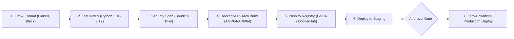

# 🚀 CI/CD Pipeline Engineering & Automation Masterclass

> Complete zero-to-hero curriculum in Continuous Integration and Continuous Delivery (CI/CD), pipeline directives matrix, multi-stage matrix testing, Docker multi-arch packaging, SLSA supply-chain security, automated secrets management, and zero-downtime deployment workflows.

---

## 📑 Curriculum & Architecture Roadmap

| Chapter | Topic | Highlights | Document |
|---|---|---|---|
| **Overview** | **Master Architecture** | Visual pipeline board, runners (GitHub vs self-hosted), directives matrix | [`CI_CD_MASTER_GUIDE.md`](docs/CI_CD_MASTER_GUIDE.md) |
| **Level 0** | **Foundations & First Pipeline** | Workflow syntax, triggers (`push`, `pull_request`, `workflow_dispatch`) | [`LEVEL_0_FOUNDATIONS_AND_FIRST_PIPELINE.md`](docs/LEVEL_0_FOUNDATIONS_AND_FIRST_PIPELINE.md) |
| **Level 1** | **Multi-Stage Matrix Testing** | Python version matrices, dependency caching (`actions/cache`), coverage artifacts | [`01_ci_test_and_lint.yml`](.github/workflows/01_ci_test_and_lint.yml) |
| **Level 2** | **Docker Multi-Arch Packaging** | Docker Buildx, QEMU emulation, automated semver release tagging | [`02_docker_build_and_push.yml`](.github/workflows/02_docker_build_and_push.yml) |
| **Level 3** | **Security & SAST Hardening** | Trivy vulnerability scanning, Bandit SAST analysis, SARIF reports | [`03_security_scan.yml`](.github/workflows/03_security_scan.yml) |
| **Level 4** | **Secret Management & Hardening** | Principle of least privilege `GITHUB_TOKEN`, secret masking, SLSA compliance | [`SECURITY_AND_SECRET_MANAGEMENT.md`](docs/SECURITY_AND_SECRET_MANAGEMENT.md) |
| **GitLab CI** | **GitLab Multi-Stage Pipeline** | Full parity `.gitlab-ci.yml` pipeline with stages, artifacts, and docker:dind | [`.gitlab-ci.yml`](.gitlab-ci.yml) |
| **Exam** | **Masterclass Examination** | 24 Multiple-choice questions with deep technical rationale | [`QUIZ.md`](QUIZ.md) |

---

## 🏛️ Pipeline Directives Matrix

| Directive | Purpose & Industrial Best Practice |
|---|---|
| `on:` | Defines trigger events (`push`, `pull_request`, `schedule`, `workflow_dispatch`). |
| `jobs.<job_id>.runs-on` | Host virtual machine environment (`ubuntu-latest`, `macos-latest`, `self-hosted`). |
| `jobs.<job_id>.needs` | Enforces execution dependency graph (e.g. `needs: [lint, test]`). |
| `strategy.matrix` | Runs parallel job variations across OS and language versions. |
| `concurrency:` | Cancels redundant in-flight builds on newly pushed PR branches to conserve CI minutes. |
| `permissions:` | Restricts `GITHUB_TOKEN` to read-only by default to prevent supply-chain privilege escalation. |
| `timeout-minutes:` | Guards against hung test runs and runaway infinite loops. |

---

## 🛠️ Complete Included Codebase & Workflows

1. **Production Python Service**: Located in [`app/`](app/), complete with calculation modules, domain services, and REST API handlers.
2. **Automated Test Suite**: Located in [`tests/`](tests/), covering edge cases, math exceptions, and domain billing calculations.
3. **Containerization**: [`Dockerfile`](Dockerfile) with non-root security unprivileged user and [`docker-compose.yml`](docker-compose.yml).
4. **Complete GitHub Actions Workflows**:
   - [`.github/workflows/01_ci_test_and_lint.yml`](.github/workflows/01_ci_test_and_lint.yml)
   - [`.github/workflows/02_docker_build_and_push.yml`](.github/workflows/02_docker_build_and_push.yml)
   - [`.github/workflows/03_security_scan.yml`](.github/workflows/03_security_scan.yml)
5. **GitLab CI Pipeline**: [`.gitlab-ci.yml`](.gitlab-ci.yml)

---

## 🧪 Masterclass Examination

Complete your mastery assessment in [`QUIZ.md`](QUIZ.md) containing 24 questions evaluating concurrency controls, caching strategies, Docker layer optimization, and pipeline security.
