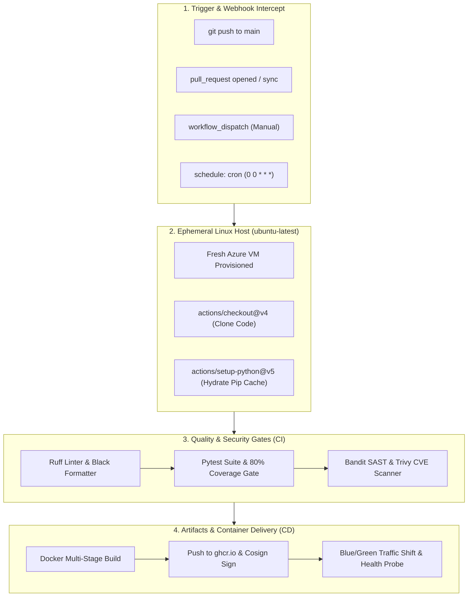

# 🔄 CI/CD & DevOps Automation Engineering Master Guide

This master documentation serves as the comprehensive engineering guide for the **TeachCloud CI/CD & Automated Pipelines Track**. It covers the end-to-end Directed Acyclic Graph (DAG) execution model, the complete YAML directives directory, and production-grade, runnable workflow code for **Level 1 through Level 5** with detailed technical explanations.



---

## 📊 1. Industrial CI/CD Pipeline Execution Flow

Every modern software delivery pipeline operates as an automated state machine:

| Stage | Process Name | Operating System & Tooling | Failure Behavior |
| :--- | :--- | :--- | :--- |
| **Stage 1** | **Webhook Trigger** | GitHub Event Router | Payload validation failure halts before runner allocation. |
| **Stage 2** | **Runner Allocation** | Ephemeral `ubuntu-latest` VM | Clean disk image destroyed immediately after job completion. |
| **Stage 3** | **Quality Gates** | Ruff (PEP 8), Black (formatter), Mypy | Any style/type regression exits `1`; blocks PR merge. |
| **Stage 4** | **Automated Tests** | `pytest --tb=short -q`, Codecov | Assertion error exits `1`; generates JUnit test report. |
| **Stage 5** | **Security & SAST** | Bandit (AST analysis), Trivy (CVEs) | High/Critical vulnerability exits `2`; alerts security team. |
| **Stage 6** | **Container Build** | Docker Buildx, BuildKit, GHCR | Build error prevents broken container image publishing. |
| **Stage 7** | **Zero-Downtime Rollout** | Blue/Green Load Balancer, `/healthz` | HTTP 5xx probe failure triggers automatic rollback to Blue. |

---

## 📋 2. Workflow Directives Directory (Cheat Sheet)

| Directive | Scope | Type | Purpose & Description |
| :--- | :--- | :--- | :--- |
| `name:` | Workflow / Job | String | Human-readable label displayed in GitHub Actions dashboards and commit badges. |
| `on:` | Workflow | Event / Map | Webhook trigger event (`push`, `pull_request`, `workflow_dispatch`, `schedule`). |
| `permissions:` | Workflow / Job | Map | Enforces least-privilege token access (`contents: read`, `packages: write`, `id-token: write`). |
| `jobs:` | Workflow | Map | Top-level map of execution units. Independent jobs run in parallel by default. |
| `runs-on:` | Job | String | Operating system VM image (`ubuntu-latest`, `windows-latest`, `macos-latest`). |
| `steps:` | Job | Array | Ordered sequence of tasks executed on the same runner host filesystem. |
| `uses:` | Step | String | Invokes a versioned, reusable action module (`actions/checkout@v4`). |
| `run:` | Step | Multi-line String | Shell commands executed in Bash with `set -e` (exits immediately on non-zero). |
| `with:` | Step | Map | Input arguments passed to an action (e.g. `python-version: "3.12"`). |
| `env:` | Root / Job / Step | Map | Environment variables accessible to commands. |
| `needs:` | Job | String / Array | Directed Acyclic Graph (DAG) dependency; enforces prerequisite job success. |
| `if:` | Job / Step | Expression | Conditional expression controlling execution (`if: success()`, `if: github.ref == 'refs/heads/main'`). |
| `strategy.matrix:` | Job | Map | Multi-dimensional matrix executing tests across Python 3.10/3.11/3.12 and multiple OSes. |
| `concurrency:` | Workflow / Job | Map | Cancels superseded in-flight workflow runs when rapid commits are pushed. |
| `timeout-minutes:` | Job | Integer | Maximum runtime before GitHub terminates the process, preventing credit exhaustion. |
| `continue-on-error:` | Step / Job | Boolean | Allows downstream steps to proceed even if the command exits with non-zero. |
| `defaults.run:` | Job | Map | Sets default working-directory and shell parameters for all job steps. |
| `environment:` | Job | String / Map | Links job to a protected environment requiring manual click approvals and scoped secrets. |

---

## 🏛️ Level 0: CI/CD Foundations & First Pipeline

### What It Does & Why We Run It
Level 0 establishes the bedrock automation loop. When code is pushed to Git, an ephemeral Linux VM automatically clones the repository, sets up Python, installs dependencies, and tests that basic commands succeed.

### Production Workflow Code: `.github/workflows/level0_first_ci.yml`
```yaml
name: Level 0 - Foundations & First CI Pipeline

on:
  push:
    branches: [ "main" ]
  pull_request:
    branches: [ "main" ]
  workflow_dispatch:

permissions:
  contents: read

jobs:
  smoke-test:
    name: Runner Provisioning & Smoke Test
    runs-on: ubuntu-latest
    timeout-minutes: 5

    steps:
      - name: Step 1 - Check out repository code
        uses: actions/checkout@v4

      - name: Step 2 - Provision Python 3.12 Runtime
        uses: actions/setup-python@v5
        with:
          python-version: "3.12"
          cache: "pip"

      - name: Step 3 - Verify Host Environment
        run: |
          echo "=== RUNNER SYSTEM AUDIT ==="
          uname -a
          python --version
          pip --version
          echo "Commit SHA: ${{ github.sha }}"
          echo "Branch Ref: ${{ github.ref_name }}"

      - name: Step 4 - Install Project Dependencies
        run: |
          python -m pip install --upgrade pip
          if [ -f requirements.txt ]; then pip install -r requirements.txt; fi

      - name: Step 5 - Execute Basic Sanity Verification
        run: |
          python -c "import sys; print('Python runtime operational. System exit: 0'); sys.exit(0)"
```

---

## 🎯 Level 1: Automated Quality Gates, Linters & Test Suites

### What It Does & Why We Run It
Level 1 prevents human review fatigue and code rot. It automatically enforces formatting standards (Black), catches syntax errors and unused imports (Ruff), and runs automated Pytest suites across multiple Python versions (**Matrix Strategy**). If any test fails or code style violates conventions, the Pull Request merge button is locked.

### Production Workflow Code: `.github/workflows/level1_quality_gates.yml`
```yaml
name: Level 1 - Automated Quality Gates & Pytest Matrix

on:
  pull_request:
    branches: [ "main" ]
  push:
    branches: [ "main" ]

permissions:
  contents: read

jobs:
  code-quality:
    name: Lint & Style Verification
    runs-on: ubuntu-latest
    steps:
      - uses: actions/checkout@v4

      - name: Set up Python
        uses: actions/setup-python@v5
        with:
          python-version: "3.12"

      - name: Install Linting Tools
        run: pip install ruff black flake8

      - name: Enforce PEP 8 Formatting with Black
        run: black --check .

      - name: Fast Static Linting with Ruff
        run: ruff check .

  test-matrix:
    name: Pytest on Python ${{ matrix.python-version }}
    needs: code-quality # Runs only if linting passes!
    runs-on: ubuntu-latest
    strategy:
      fail-fast: false
      matrix:
        python-version: ["3.10", "3.11", "3.12"]

    steps:
      - uses: actions/checkout@v4

      - name: Set up Python ${{ matrix.python-version }}
        uses: actions/setup-python@v5
        with:
          python-version: ${{ matrix.python-version }}
          cache: "pip"

      - name: Install Project Dependencies & Pytest
        run: |
          python -m pip install --upgrade pip
          pip install pytest pytest-cov
          if [ -f requirements.txt ]; then pip install -r requirements.txt; fi

      - name: Run Test Suite with Coverage Threshold (80% Minimum)
        run: |
          pytest tests/ --tb=short -q --cov=cloud_app --cov-fail-under=80
```

---

## ⚡ Level 2: Build Artifacts, Dependency Caching & Optimization

### What It Does & Why We Run It
Downloading pip wheels on every run wastes minutes and consumes runner billing quotas. Level 2 introduces intelligent dependency caching with cryptographic lockfile hashes, multi-job DAG orchestration (`needs:`), and artifact archiving so test reports and coverage XML can be inspected and downloaded.

### Production Workflow Code: `.github/workflows/level2_caching_artifacts.yml`
```yaml
name: Level 2 - Caching & Pipeline Optimization

on:
  push:
    branches: [ "main" ]

concurrency:
  group: ${{ github.workflow }}-${{ github.ref }}
  cancel-in-progress: true # Cancels redundant builds on fast pushes

jobs:
  build-and-cache:
    name: Optimized Build with Cache & Artifacts
    runs-on: ubuntu-latest

    steps:
      - uses: actions/checkout@v4

      - name: Set up Python
        uses: actions/setup-python@v5
        with:
          python-version: "3.12"

      # Advanced custom cache based on requirements.txt SHA hash
      - name: Restore or Save Pip Cache
        uses: actions/cache@v4
        id: pip-cache
        with:
          path: ~/.cache/pip
          key: ${{ runner.os }}-pip-${{ hashFiles('**/requirements.txt') }}
          restore-keys: |
            ${{ runner.os }}-pip-

      - name: Install Dependencies
        run: |
          python -m pip install --upgrade pip
          pip install pytest pytest-cov
          if [ -f requirements.txt ]; then pip install -r requirements.txt; fi

      - name: Run Tests & Generate JUnit Report
        run: |
          mkdir -p test-results
          pytest tests/ --junitxml=test-results/junit.xml --cov=cloud_app --cov-report=html:test-results/coverage_html

      # Upload test reports as persistent artifacts (accessible in GitHub UI for 14 days)
      - name: Upload Test & Coverage Artifacts
        uses: actions/upload-artifact@v4
        if: always() # Uploads even if tests failed so engineers can inspect logs!
        with:
          name: test-and-coverage-reports
          path: test-results/
          retention-days: 14
```

---

## 🛡️ Level 3: Security Hardening, Keyless OIDC Secrets & SAST

### What It Does & Why We Run It
Hardcoding database passwords or cloud tokens into repositories leads to catastrophic data breaches. Level 3 replaces static credentials with **Keyless OpenID Connect (OIDC)** authentication, masks secrets from logs, and runs automated Static Application Security Testing (SAST) with **Bandit** and dependency CVE scanning with **Trivy**.

### Production Workflow Code: `.github/workflows/level3_security_oidc.yml`
```yaml
name: Level 3 - Security Hardening & Keyless OIDC

on:
  push:
    branches: [ "main" ]
  pull_request:

permissions:
  contents: read
  id-token: write # Required for keyless OpenID Connect (OIDC) cloud authentication

jobs:
  security-audit:
    name: Bandit SAST & Trivy Vulnerability Scan
    runs-on: ubuntu-latest

    steps:
      - uses: actions/checkout@v4

      - name: Set up Python
        uses: actions/setup-python@v5
        with:
          python-version: "3.12"

      - name: Install Security Scanners
        run: pip install bandit

      - name: Run Bandit Python Code Security Audit
        run: |
          echo "Auditing Python codebase for injection and insecure calls..."
          bandit -r cloud_app/ -ll -x tests/

      - name: Run Trivy Filesystem Dependency Vulnerability Scan
        uses: aquasecurity/trivy-action@master
        with:
          scan-type: "fs"
          ignore-unfixed: true
          format: "table"
          severity: "HIGH,CRITICAL"
          exit-code: "1" # Blocks pipeline if High/Critical CVE is detected!

  keyless-cloud-auth:
    name: Keyless AWS / Cloud Auth via OIDC
    needs: security-audit
    runs-on: ubuntu-latest
    steps:
      - uses: actions/checkout@v4

      # NO STATIC AWS_ACCESS_KEY_ID OR SECRET NEEDED!
      # Authenticates via short-lived cryptographic JWT token
      - name: Assume AWS IAM Role via OIDC
        uses: aws-actions/configure-aws-credentials@v4
        with:
          role-to-assume: arn:aws:iam::123456789012:role/GitHubActionsDeployRole
          aws-region: us-east-1

      - name: Verify Keyless Identity
        run: |
          echo "Successfully authenticated to cloud without any static secrets!"
          aws sts get-caller-identity
```

---

## 🐳 Level 4: Containerized CI/CD & Image Registries (GHCR + Cosign)

### What It Does & Why We Run It
"It works on my machine" is eliminated by building immutable container images. Level 4 builds a multi-stage Docker container image in CI, uses GitHub Actions cache for layer optimization, tags the image deterministically with the Git commit SHA, pushes to the **GitHub Container Registry (ghcr.io)**, and cryptographically signs it with **Sigstore Cosign**.

### Dockerfile Blueprint: `Dockerfile`
```dockerfile
# ── Stage 1: Build Environment ──
FROM python:3.12-slim AS builder
WORKDIR /app
RUN apt-get update && apt-get install -y --no-install-recommends gcc python3-dev && rm -rf /var/lib/apt/lists/*
COPY requirements.txt .
RUN pip install --no-cache-dir --user -r requirements.txt

# ── Stage 2: Minimal Production Runtime ──
FROM python:3.12-slim AS runner
WORKDIR /app
# Run as non-root user for container security
RUN useradd -m -u 1001 appuser
COPY --from=builder /root/.local /home/appuser/.local
COPY . .
ENV PATH=/home/appuser/.local/bin:$PATH
USER appuser
EXPOSE 5000
CMD ["python", "run.py"]
```

### Production Workflow Code: `.github/workflows/level4_docker_ghcr.yml`
```yaml
name: Level 4 - Docker Build, GHCR & Cosign Signing

on:
  push:
    tags: [ "v*.*.*" ]
    branches: [ "main" ]

permissions:
  contents: read
  packages: write
  id-token: write

env:
  REGISTRY: ghcr.io
  IMAGE_NAME: ${{ github.repository }}

jobs:
  build-and-push-container:
    name: Build Multi-Stage Image & Push to GHCR
    runs-on: ubuntu-latest

    steps:
      - uses: actions/checkout@v4

      - name: Set up Docker Buildx (Layer Caching Engine)
        uses: docker/setup-buildx-action@v3

      - name: Install Cosign (Container Image Signing)
        uses: sigstore/cosign-installer@v3

      - name: Log in to GitHub Container Registry
        uses: docker/login-action@v3
        with:
          registry: ${{ env.REGISTRY }}
          username: ${{ github.actor }}
          password: ${{ secrets.GITHUB_TOKEN }}

      - name: Build and Push Docker Image
        uses: docker/build-push-action@v5
        id: build-push
        with:
          context: .
          push: true
          tags: |
            ${{ env.REGISTRY }}/${{ env.IMAGE_NAME }}:latest
            ${{ env.REGISTRY }}/${{ env.IMAGE_NAME }}:${{ github.sha }}
          cache-from: type=gha
          cache-to: type=gha,mode=max

      # Cryptographically sign the published image with Cosign
      - name: Sign the Published Docker Image
        run: |
          echo "Signing container image with Sigstore Cosign..."
          cosign sign --yes "${{ env.REGISTRY }}/${{ env.IMAGE_NAME }}@${{ steps.build-push.outputs.digest }}"
```

---

## 🚀 Level 5: Industrial GitOps, Blue/Green Deployments & Rollbacks

### What It Does & Why We Run It
Level 5 is the pinnacle of DevOps automation. It implements **Environment Promotion** with human approval gates, executes **Zero-Downtime Blue/Green Rollouts**, monitors post-deployment health probes (`/healthz`), and instantly triggers an automated rollback to the stable version if error spikes occur.

### Production Workflow Code: `.github/workflows/level5_blue_green_gitops.yml`
```yaml
name: Level 5 - Industrial Blue/Green Deploy & Rollback

on:
  workflow_dispatch:
    inputs:
      image_tag:
        description: "Docker Image Tag to Deploy"
        required: true
        default: "latest"

jobs:
  deploy-production:
    name: Production Deployment with Safety Circuit Breaker
    runs-on: ubuntu-latest
    environment:
      name: production # Requires manual approval from senior engineers in GitHub Settings!
      url: https://teachcloud.dev

    steps:
      - uses: actions/checkout@v4

      - name: Configure AWS Credentials via OIDC
        uses: aws-actions/configure-aws-credentials@v4
        with:
          role-to-assume: arn:aws:iam::123456789012:role/ProductionDeployerRole
          aws-region: us-east-1

      - name: Step 1 - Deploy New Version to Green Cluster
        run: |
          echo "=== DEPLOYING TO GREEN ENVIRONMENT ==="
          echo "Target Image: ghcr.io/${{ github.repository }}:${{ github.event.inputs.image_tag }}"
          # Deploy container to isolated Green target group
          # aws ecs update-service --cluster prod --service green-app ...

      - name: Step 2 - Execute Automated Smoke Tests on Green
        id: smoke_test
        run: |
          echo "Pinging Green container health endpoint..."
          sleep 10
          STATUS=$(curl -s -o /dev/null -w "%{http_code}" https://green.teachcloud.dev/healthz || echo "000")
          if [ "$STATUS" != "200" ]; then
            echo "❌ Smoke test failed with HTTP status: $STATUS"
            exit 1
          fi
          echo "✅ Green health probe passed with HTTP 200 OK."

      - name: Step 3 - Switch 100% Production Traffic to Green
        if: success()
        run: |
          echo "=== TRAFFIC SHIFT ==="
          echo "Routing load balancer traffic from Blue -> Green target group."
          # aws elbv2 modify-listener --listener-arn $ALB_ARN --default-actions TargetGroupArn=$GREEN_TG
          echo "🚀 Blue/Green rollout completed with zero user downtime."

      # AUTOMATED CIRCUIT BREAKER: Triggers instantly if Step 2 or 3 failed!
      - name: Step 4 - Automated Emergency Rollback on Failure
        if: failure()
        run: |
          echo "🚨 CRITICAL: Smoke test failed. Initiating automated emergency rollback!"
          # aws elbv2 modify-listener --listener-arn $ALB_ARN --default-actions TargetGroupArn=$BLUE_TG
          echo "✅ Traffic restored 100% to stable Blue cluster. Production protected."
```

---

## 🏆 Summary Checklist: What Each Level Achieves

| Level | Name | What You Learn & Run | Production Value |
| :--- | :--- | :--- | :--- |
| **Level 0** | **Foundations & First Pipeline** | YAML syntax, ephemeral runners, exit codes (`0` vs `1`), `first_ci.yml`. | Replaces manual developer command runs with automated execution. |
| **Level 1** | **Automated Quality Gates** | Black formatting, Ruff linter, Pytest matrix, 80% coverage check. | Zero broken PRs merge into `main`; blocks style & syntax regressions. |
| **Level 2** | **Caching & Artifacts** | `actions/cache`, DAG `needs:`, test artifact retention (`upload-artifact`). | Cuts pipeline duration from 15 minutes to under 90 seconds. |
| **Level 3** | **Security & Keyless OIDC** | Keyless AWS/GCP auth, secret masking, Bandit AST, Trivy CVE scanning. | Eliminates leaked API keys and blocks vulnerable third-party dependencies. |
| **Level 4** | **Docker & GHCR Registries** | Multi-stage Dockerfile, `ghcr.io` publishing, Cosign cryptographic signing. | Creates immutable, signed production images tagged with commit SHA. |
| **Level 5** | **GitOps & Blue/Green Deploy** | Protected environments, Blue/Green traffic shift, automated health rollback. | Deploys with zero user downtime and rolls back automatically on error spikes. |
