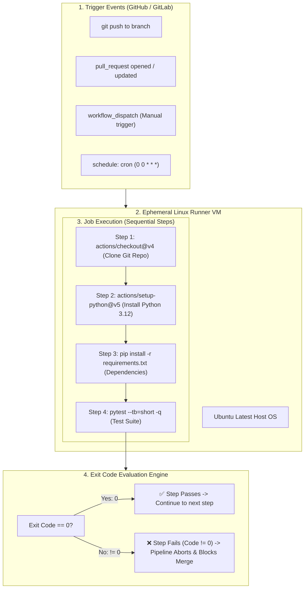
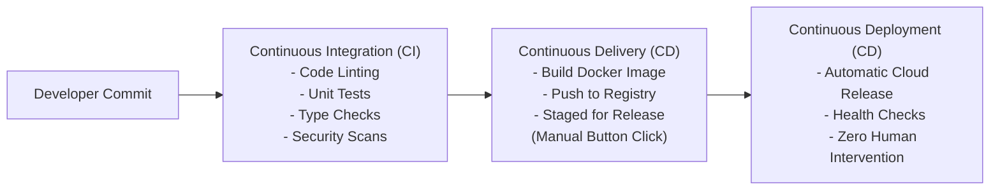

# 🔄 Level 0: CI/CD Foundations, YAML Architecture & First Pipeline

Welcome to the foundational tier of the **CI/CD & DevOps Pipeline Masterclass**. Before writing complex multi-stage deployment scripts, cloud engineers must master the fundamental mechanics of automated pipelines: the Continuous Integration lifecycle, the runner execution environment, YAML grammar, trigger events, and how process exit codes govern pipeline success or failure.



---

## 🏛️ 1. The CI/CD Mental Model: Integration vs Delivery vs Deployment

In modern software organizations, manual releases create bottlenecks, regressions, and deployment anxiety. CI/CD transforms release management into a continuous, automated feedback loop.

### The Three Tiers of Automation



| Dimension | Continuous Integration (CI) | Continuous Delivery (CD) | Continuous Deployment (CD) |
| :--- | :--- | :--- | :--- |
| **Primary Goal** | Detect bugs early and keep `main` branch always green and releasable. | Automatically prepare release-ready artifacts for production deployment. | Deploy every passing commit directly into production environments. |
| **Trigger** | On every `git push` or `pull_request` creation. | After merge into `main` or release tag (`v*.*.*`). | Automatically upon passing all staging and integration tests. |
| **Production Impact** | Zero (only validates code). | Low risk (release is staged; human approves rollout). | High leverage (code reaches users in minutes). |
| **Failure Result** | Blocks pull request merge; notifies developer immediately. | Artifact is discarded; release pipeline stops. | Deployment halts; automatic rollback restores previous version. |

---

## ⚙️ 2. Anatomy of a Pipeline Engine

Every major pipeline orchestrator—**GitHub Actions**, **GitLab CI/CD**, **Jenkins**, and **Bitbucket Pipelines**—operates on the same 5 core building blocks:

### 1. Triggers (`on:`)
Triggers define the event that wakes up the pipeline scheduler:
* `push`: Runs when commits are pushed to specified branches or paths.
* `pull_request`: Runs when a pull request is opened, synchronized (new commits added), or reopened.
* `workflow_dispatch`: Enables a manual "Run workflow" button with custom input fields in the web UI.
* `schedule`: Runs recurring jobs at set intervals using POSIX cron syntax (e.g., nightly test suites).

### 2. The Runner (`runs-on:`)
A runner is the virtual machine or container executing your jobs:
* **GitHub-Hosted Runners**: Fresh, ephemeral Linux (`ubuntu-latest`), Windows (`windows-latest`), or macOS (`macos-14`) VMs provisioned on Microsoft Azure infrastructure. Each run gets a completely pristine disk image destroyed immediately after job completion.
* **Self-Hosted Runners**: Dedicated servers, on-premise hardware, or Kubernetes pods managed by your team for customized hardware (GPUs) or internal network access.

### 3. The Job (`jobs.<job_id>`)
A job is a sequence of steps executed on the **same runner instance**:
* By default, independent jobs run **in parallel** to minimize total build time.
* Jobs can be chained sequentially using the `needs:` directive (`job2` waits for `job1` to complete successfully).

### 4. The Step (`steps:`)
Steps are individual tasks within a job. They execute sequentially and share the runner's local filesystem:
* **Shell Command (`run:`)**: Runs bash commands directly in the runner terminal.
* **Action (`uses:`)**: Reusable, versioned automation modules from the marketplace (e.g. checking out code, installing runtimes, logging into cloud providers).

### 5. The Exit Code (`$?` Return Value)
* The pipeline engine monitors the Linux process return code after every command.
* In Unix:
  * `exit 0` = **Success** (Step marked green).
  * `exit 1` through `255` = **Failure** (Step marked red; execution terminates immediately).
* Runners enforce `set -e` by default in bash, meaning the first command in a multi-line script that returns non-zero aborts the entire step.

---

## 📝 3. YAML Syntax Architecture for DevOps Engineers

Pipelines are written in **YAML** (YAML Ain't Markup Language). Because YAML relies strictly on indentation for structure, a single misaligned space will prevent the entire workflow from parsing.

### Strict YAML Rules to Memorize
1. **Never use Tab characters**: Always indent using **2 spaces**. Tabs cause immediate parser syntax errors.
2. **Key-Value Pairs**: Must be separated by a colon followed by a space:
   ```yaml
   key: value      # Correct
   key:value       # WRONG: Parser failure
   ```
3. **Lists / Sequences**: Preceded by a hyphen and a space:
   ```yaml
   branches:
     - main
     - develop
   ```
4. **Multi-line Scripts**:
   * Use pipe `|` to preserve newlines (standard for multi-line bash scripts):
     ```yaml
     run: |
       echo "Starting test suite..."
       pytest tests/
       echo "Tests completed successfully."
     ```
   * Use folded `>` to collapse multi-line text into a single line string.

---

## 🎯 4. Contexts, Expressions & Dynamic Variables

GitHub Actions provides rich runtime context variables accessible via `${{ <expression> }}`:

| Context Variable | Example Value | Production Purpose |
| :--- | :--- | :--- |
| `${{ github.sha }}` | `a1b2c3d4e5f6...` | Immutable commit hash; used to tag Docker images deterministically. |
| `${{ github.ref_name }}` | `main` or `feature-auth` | Name of the checked-out branch; used for environment gating. |
| `${{ github.event_name }}` | `push` or `pull_request` | Differentiating pipeline behavior based on trigger event. |
| `${{ runner.os }}` | `Linux` | Used in cache keys to isolate operating system dependencies. |

### Passing Dynamic Outputs Between Steps
When Step 1 calculates a value needed by Step 2, write to the special `$GITHUB_OUTPUT` environment file:

```yaml
- name: Calculate Release Version
  id: get_version
  run: |
    APP_VER=$(python -c "import cloud_app; print('v1.4.0')")
    echo "version=$APP_VER" >> $GITHUB_OUTPUT

- name: Print Version from Previous Step
  run: |
    echo "Generated Version: ${{ steps.get_version.outputs.version }}"
```

---

## 🛠️ 5. Hands-on Tutorial: Writing Your First Production Pipeline

Create a file at `.github/workflows/first_ci.yml` in your repository root with the following verified configuration:

```yaml
name: TeachCloud Backend CI

# 1. Triggers
on:
  push:
    branches: [ "main" ]
  pull_request:
    branches: [ "main" ]
  workflow_dispatch:

# 2. Permissions (Principle of least privilege)
permissions:
  contents: read

# 3. Jobs
jobs:
  validate-and-test:
    name: Lint & Pytest Suite
    runs-on: ubuntu-latest
    timeout-minutes: 10

    steps:
      # Step 1: Clone the repository into runner workspace
      - name: Check out repository
        uses: actions/checkout@v4

      # Step 2: Provision isolated Python runtime
      - name: Set up Python 3.12
        uses: actions/setup-python@v5
        with:
          python-version: "3.12"
          cache: "pip" # Enables automatic pip dependency caching

      # Step 3: Install application requirements
      - name: Install dependencies
        run: |
          python -m pip install --upgrade pip
          if [ -f requirements.txt ]; then pip install -r requirements.txt; fi

      # Step 4: Run automated test suite
      - name: Run Pytest
        run: |
          echo "Running automated test suite on commit: ${{ github.sha }}"
          pytest tests/test_git_level0.py --tb=short -q

      # Step 5: Verification reporting
      - name: Pipeline Health Summary
        if: success()
        run: echo "🚀 All pipeline quality gates passed successfully!"
```

---

## 🚨 6. Common Pipeline Traps & How to Avoid Them

| Rookie Mistake | Manifestation | Root Cause & Production Fix |
| :--- | :--- | :--- |
| **Tab Character Indentation** | `mapping values are not allowed here` | Tabs used instead of 2 spaces. Set editor to "Spaces: 2" and configure `.editorconfig`. |
| **Missing Checkout Step** | `ls: cannot access 'requirements.txt': No such file` | The runner is a completely empty VM. You must explicitly execute `actions/checkout@v4` as the very first step. |
| **Uncached Dependencies** | Pipeline takes 8 minutes every run downloading pip packages | Missing `cache: 'pip'`. Always enable runtime caching to cut build times by 75%. |
| **Ignoring Exit Codes** | Broken tests don't stop deployment | Command executed with `\|\| true` or wrapped in a script that catches errors without re-raising `exit 1`. |
| **Long-Running Hangs** | Pipeline consumes all GitHub free minutes | A test or process hung waiting for stdin input. Always specify `timeout-minutes: 10` on all jobs. |

---

## 🧪 7. Level 0 Self-Assessment Checklist

Before proceeding to Level 1 (Quality Gates & Matrix Testing), verify you can answer:
- [x] Why does a pipeline runner start completely empty on every commit?
- [x] What is the difference between a step with `uses:` vs a step with `run:`?
- [x] How does the pipeline engine know if a step succeeded or failed?
- [x] Why should you never use hardcoded credentials in YAML files?
- [x] How do `push` and `pull_request` triggers differ in branch workflows?
