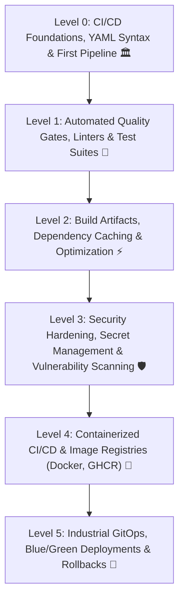

# 🔄 CI/CD & Automated DevOps Pipelines Masterclass Curriculum

Welcome to the comprehensive **CI/CD & DevOps Pipeline Engineering Masterclass** for TeachCloud. This multi-level curriculum takes software engineers and cloud practitioners from zero pipeline experience to building resilient, enterprise-grade Continuous Integration and Continuous Deployment systems using industry-standard platforms (GitHub Actions, GitLab CI, Docker, and Kubernetes/Cloud deployment engines).



---

## 🗺️ Curriculum Blueprint & Tier Architecture

| Level | Designation | Core Competencies | Primary Technologies & Concepts | Real-World Production Context |
| :--- | :--- | :--- | :--- | :--- |
| **Level 0** | **CI/CD Foundations & First Pipeline** | CI vs CD mental model, YAML specification, runner lifecycle, exit codes, trigger events | GitHub Actions, Runner VMs (`ubuntu-latest`), YAML syntax, exit codes (`0` vs `!= 0`), `workflow_dispatch` | Eliminating manual deployments, running first automated check on push, understanding headless runner environments. |
| **Level 1** | **Automated Quality Gates & Testing** | Pre-merge verification, Python linting (`ruff`/`flake8`), static type checking (`mypy`), unit testing with coverage | `pytest --tb=short`, Codecov, coverage thresholds, branch protection rules, Matrix builds | Preventing broken code from reaching `main`, blocking syntax regressions, testing across Python 3.10/3.11/3.12. |
| **Level 2** | **Artifacts, Caching & Pipeline Speed** | Pipeline optimization, dependency caching (`actions/cache`), build artifacts, parallel jobs | Caching `pip`/`npm`, `actions/upload-artifact`, job dependency graphs (`needs: [lint, test]`), concurrency groups | Slashing build times from 15 minutes to 90 seconds, archiving test reports and distributable binaries. |
| **Level 3** | **Secrets, Security & SAST Scans** | Zero-trust secrets management, environment secrets, software supply chain security, automated vulnerability scans | GitHub Secrets, OIDC cloud auth (AWS/GCP/Azure without static keys), Trivy, Bandit, Dependabot | Preventing API key leakage, auditing third-party npm/pip vulnerabilities, zero-token cloud authorization. |
| **Level 4** | **Dockerization & Container Registries** | Multi-stage Docker builds in CI, image optimization, GitHub Container Registry (GHCR) publishing, image signing | Dockerfile optimization, `docker/build-push-action`, GHCR (`ghcr.io`), Cosign signature verification | Creating immutable production images, automated version tagging (`v1.4.2`), multi-architecture builds (`amd64`/`arm64`). |
| **Level 5** | **Continuous Deployment & GitOps** | Environment progression (Dev -> Staging -> Prod), manual approval gates, Blue/Green rollouts, automated rollbacks | Kubernetes, ArgoCD, Helm, AWS ECS/EKS, Blue/Green traffic shifting, health check triggers | Deploying to production without user downtime, instant automated rollback on HTTP 5xx error spikes. |

---

## 📚 Detailed Syllabus Breakdown

### Level 0: CI/CD Foundations, YAML Syntax & First Pipeline 🏛️
*Documentation: [`docs/CICD/LEVEL_0_FOUNDATIONS_AND_FIRST_PIPELINE.md`](LEVEL_0_FOUNDATIONS_AND_FIRST_PIPELINE.md)*
*Target Milestone: Understanding the automation engine, mastering YAML schema, and executing a verified pipeline with status badges.*

* **Lesson 0.1 — The CI/CD Mental Model: Integration vs Delivery vs Deployment**
  * The manual software release crisis: "Works on my machine" syndrome and release bottlenecks.
  * Continuous Integration (CI): Frequent automated commits, automated testing, and branch protection.
  * Continuous Delivery (CD): Deployable build artifacts generated and staged on demand.
  * Continuous Deployment (CD): Fully automated production rollout with automated safety gates.
* **Lesson 0.2 — Anatomy of a Pipeline Engine**
  * The Trigger Event: `push`, `pull_request`, `workflow_dispatch` (manual), `schedule` (cron).
  * The Runner: Ephemeral headless Linux VMs (Ubuntu, Windows, macOS) and self-hosted runners.
  * The Job: Parallel vs sequential units of execution (`runs-on: ubuntu-latest`).
  * The Step: Discrete commands (`run: pytest`) or reusable actions (`uses: actions/checkout@v4`).
  * The Exit Code: Why `0` means pass, `!= 0` triggers pipeline failure, and how `set -e` works.
* **Lesson 0.3 — YAML for DevOps Engineers**
  * YAML syntax fundamentals: Key-value pairs, nested dictionaries, scalar lists, multi-line strings (`|` and `>`).
  * Indentation rules (2 spaces, strict prohibition of Tab characters).
  * Common syntax pitfalls that break pipeline parsers.
* **Lesson 0.4 — Contexts, Variables & Dynamic Expressions**
  * Workflow expressions: `${{ github.sha }}`, `${{ github.ref_name }}`, `${{ runner.os }}`.
  * Defining custom environment variables at root, job, and step levels (`env:`).
  * Setting dynamic outputs between steps using `$GITHUB_OUTPUT`.
* **Lesson 0.5 — Authoring & Triggering Your First Pipeline**
  * Directory layout: `.github/workflows/ci.yml`.
  * Testing locally with `act` (Docker-based GitHub Actions runner emulator).
  * Adding live build status badges (``) to repository READMEs.

---

### Level 1: Automated Quality Gates, Linters & Test Suites 🎯
*Documentation: `docs/CICD/LEVEL_1_QUALITY_GATES_AND_TESTING.md`*
*Target Milestone: Establishing strict automated gates where no pull request can merge without passing linting, type checks, and unit tests.*

* **Lesson 1.1 — Code Quality & Static Analysis Gates**
  * Python linting with Ruff and Flake8: Enforcing PEP 8 standards automatically.
  * Code formatting with Black: Zero code review arguments on styling.
  * Static type checking with Mypy: Catching runtime `NoneType` bugs before deployment.
* **Lesson 1.2 — Automated Testing with Pytest**
  * Setting up test dependencies in clean runners.
  * Running tests with concise failure output: `pytest --tb=short -q`.
  * Mocking external databases and APIs: Guaranteeing deterministic, zero-network test runs.
* **Lesson 1.3 — Code Coverage & Quality Threshold Enforcement**
  * Generating coverage reports (`pytest --cov=cloud_app --cov-report=xml`).
  * Setting non-negotiable minimum coverage thresholds (`--cov-fail-under=80`).
  * Integrating automated PR comments with test summaries.
* **Lesson 1.4 — Matrix Strategy (Multi-Version & Multi-OS Testing)**
  * Running identical test suites across Python 3.10, 3.11, and 3.12 in parallel.
  * Cross-platform verification: Testing on `ubuntu-latest`, `windows-latest`, and `macos-latest`.
  * `fail-fast: false` vs `fail-fast: true` configurations.
* **Lesson 1.5 — Branch Protection Rules & Status Checks**
  * Configuring GitHub repository branch protection on `main`.
  * Requiring linear history and pull request approvals before merging.
  * Setting mandatory status checks (`backend-tests` must pass before the Merge button activates).

---

### Level 2: Build Artifacts, Dependency Caching & Optimization ⚡
*Documentation: `docs/CICD/LEVEL_2_ARTIFACTS_AND_OPTIMIZATION.md`*
*Target Milestone: Slashing pipeline execution time by up to 80% with intelligent caching and multi-job dependency trees.*

* **Lesson 2.1 — Dependency Caching Mechanics**
  * Why downloading Python wheels / npm packages on every run wastes minutes and API rate limits.
  * Using `actions/setup-python` with built-in `cache: 'pip'`.
  * Advanced caching with `actions/cache`: Custom cache keys (`${{ runner.os }}-pip-${{ hashFiles('**/requirements.txt') }}`).
* **Lesson 2.2 — Job Dependency Graphs (`needs:`)**
  * Orchestrating parallel vs sequential pipelines:
    ```yaml
    jobs:
      lint:
        runs-on: ubuntu-latest
        ...
      test:
        needs: lint
        runs-on: ubuntu-latest
        ...
      build:
        needs: [lint, test]
        runs-on: ubuntu-latest
        ...
    ```
  * Fast-fail optimization: Halting downstream expensive builds immediately if linting fails.
* **Lesson 2.3 — Uploading & Downloading Pipeline Artifacts**
  * Archiving compiled assets, test logs, coverage HTML, and wheel packages.
  * Using `actions/upload-artifact@v4` and `actions/download-artifact@v4`.
  * Setting artifact retention periods to prevent storage bloat.
* **Lesson 2.4 — Concurrency & Cancellation Controls**
  * Preventing queue pile-ups when a developer pushes 5 commits in 2 minutes.
  * Using `concurrency: group: ${{ github.ref }}, cancel-in-progress: true`.

---

### Level 3: Security Hardening, Secret Management & Vulnerability Scanning 🛡️
*Documentation: `docs/CICD/LEVEL_3_SECURITY_AND_SECRETS.md`*
*Target Milestone: Implementing zero-trust CI/CD, eliminating long-lived credentials with OpenID Connect (OIDC), and automated SAST/DAST.*

* **Lesson 3.1 — Secrets Management Architecture**
  * GitHub Repository Secrets vs Organization Secrets vs Environment Secrets.
  * Log masking: How CI systems automatically redact `${{ secrets.API_KEY }}` from stdout.
  * Pitfalls: Accidental secret leakage via base64 encoding or error traces.
* **Lesson 3.2 — Keyless Cloud Authentication with OpenID Connect (OIDC)**
  * The danger of static, long-lived AWS IAM access keys or GCP service account JSON files.
  * How OIDC works: Short-lived cryptographic JWT tokens exchanged between GitHub and AWS STS / GCP Workload Identity.
  * Configuring `permissions: id-token: write`.
* **Lesson 3.3 — Static Application Security Testing (SAST)**
  * Auditing Python security flaws with Bandit (`bandit -r cloud_app/`).
  * Enforcing dependency vulnerability scanning with Trivy and `pip-audit`.
  * Automated security pull request alerts with Dependabot.
* **Lesson 3.4 — Hardening Pipeline Runners**
  * Principle of least privilege: Limiting default `GITHUB_TOKEN` permissions (`contents: read`).
  * Pinning third-party GitHub Actions by full commit SHA instead of mutable tags (`@v4` vs `@sha123`).

---

### Level 4: Containerized CI/CD & Image Registries 🐳
*Documentation: `docs/CICD/LEVEL_4_CONTAINER_REGISTRIES.md`*
*Target Milestone: Multi-stage Docker builds, image layer caching, automated SemVer tagging, and publishing to GitHub Container Registry.*

* **Lesson 4.1 — Multi-Stage Dockerfile Optimization in CI**
  * Separation of build-time dependencies (compilers, headers) and runtime slim images.
  * Non-root security user (`USER appuser`) configuration.
  * Creating deterministic container tags (`${{ github.sha }}` and SemVer tags).
* **Lesson 4.2 — GitHub Container Registry (GHCR) Integration**
  * Authenticating with `ghcr.io` using ephemeral `${{ secrets.GITHUB_TOKEN }}`.
  * Building and pushing images with Docker Buildx (`docker/build-push-action@v5`).
  * Utilizing GitHub Actions cache backend for Docker layers (`type=gha`).
* **Lesson 4.3 — Container Vulnerability Scanning**
  * Scanning built container images for OS CVEs before pushing to production.
  * Blocking container promotion if Critical or High severity CVEs are detected.
* **Lesson 4.4 — Cryptographic Image Signing with Cosign**
  * Signing container images with Sigstore Cosign.
  * Verifying image provenance and supply chain integrity prior to Kubernetes deployment.

---

### Level 5: Industrial GitOps, Blue/Green Deployments & Rollbacks 🚀
*Documentation: `docs/CICD/LEVEL_5_GITOPS_AND_DEPLOYMENT.md`*
*Target Milestone: Automated multi-environment delivery, zero-downtime Blue/Green deployments, canary rollouts, and instant automated rollbacks.*

* **Lesson 5.1 — Environment Promotion Pipelines (Dev -> Staging -> Prod)**
  * Defining GitHub Environments with required reviewers (Manual Approval Gates).
  * Enforcing deployment protection rules and environment-specific secrets.
* **Lesson 5.2 — Zero-Downtime Deployment Strategies**
  * Rolling Deployments: Updating replicas incrementally.
  * Blue/Green Deployments: Routing 100% traffic from Blue to Green after synthetic health check passes.
  * Canary Deployments: Routing 5% -> 25% -> 100% traffic based on real-time error rates.
* **Lesson 5.3 — Automated Health Checks & Instant Rollbacks**
  * Automated post-deployment smoke tests (`curl -f https://api.teachcloud.dev/healthz`).
  * Triggering automatic rollback to previous stable commit if latency or 5xx error spikes occur.
* **Lesson 5.4 — The GitOps Paradigm with ArgoCD & Flux**
  * Push-based vs Pull-based deployment models.
  * Git as the single source of truth for infrastructure state.
  * Automatic drift detection and reconciliation loops.

---

## 🏆 Production Mastery Checkpoints

1. **Gate 1**: Any broken test or syntax error opened in a PR immediately fails the pipeline and blocks merge.
2. **Gate 2**: Build cache reduces pipeline time to under 2 minutes.
3. **Gate 3**: Zero static cloud credentials exist anywhere in repo settings (100% OIDC).
4. **Gate 4**: Every production release produces an immutable, signed Docker image tagged with Git SHA.
5. **Gate 5**: Deployments happen with zero downtime and roll back automatically on health check failure.
