# CI/CD Pipeline Architecture & Master Flowchart (Levels 0 to 5)

This document provides the complete end-to-end architecture, repository blueprint, and visual flowcharts for deploying the 6-tier CI/CD automation pipeline in a modern cloud-native repository (e.g. **`cloud_devops_service`**).

---

## 1. Directory Blueprint: Where Every Workflow Lives

In GitHub Actions, workflows **must** reside in the `.github/workflows/` directory located at the root of your repository. 

Here is the exact repository file tree for **`cloud_devops_service`**:

```text
cloud_devops_service/
├── .github/
│   └── workflows/
│       ├── level0_first_ci.yml          # Level 0: Ephemeral Runner & Environment Sanity
│       ├── level1_quality_gates.yml      # Level 1: Linting, Formatting & Multi-Python Matrix
│       ├── level2_caching_artifacts.yml  # Level 2: Dependency Caching & Test Report Artifacts
│       ├── level3_security_oidc.yml      # Level 3: SAST, Container Scanning & Keyless Cloud Auth
│       ├── level4_docker_ghcr.yml        # Level 4: Multi-Stage Docker Build & Cosign Signing
│       └── level5_blue_green_gitops.yml  # Level 5: Zero-Downtime Blue/Green Production Rollout
├── app/                                 # Application source code
├── tests/                               # Pytest automated test suites
├── Dockerfile                           # Production container blueprint (used in Level 4)
├── requirements.txt                     # Python production & test dependencies
└── pytest.ini                           # Test configuration & coverage thresholds
```

> [!IMPORTANT]
> GitHub Actions automatically parses any `.yml` or `.yaml` file located in `.github/workflows/`. You do not need any external server or Jenkins agent; GitHub manages the virtual machines.

---

## 2. Master CI/CD Pipeline Flowchart (Level 0 → Level 5)

The following flowchart illustrates how code moves from a developer's local commit through each stage, and how each level builds upon the previous one:

```mermaid
flowchart TD
    subgraph Trigger ["1. Trigger Phase"]
        DEV["Developer Commit / PR"] -->|"git push origin main"| GH["GitHub Webhook Event"]
    end

    subgraph L0 ["Level 0: Foundations & Environment"]
        GH --> L0_RUN["Allocate ubuntu-latest VM"]
        L0_RUN --> L0_CHK["Checkout Code (actions/checkout@v4)"]
        L0_CHK --> L0_PY["Provision Python 3.12 Runtime"]
        L0_PY --> L0_SANITY["Sanity Check: exit code 0"]
    end

    subgraph L1 ["Level 1: Automated Quality Gates"]
        L0_SANITY -->|"Pass (Exit 0)"| L1_GATE{"Quality Gates (DAG)"}
        L1_GATE -->|"Job 1: Static Lint"| L1_RUFF["Ruff & Black Formatting"]
        L1_GATE -->|"Job 2: Parallel Matrix"| L1_MAT["Pytest Matrix: Python 3.10, 3.11, 3.12"]
        L1_MAT --> L1_COV{"Coverage >= 80%?"}
        L1_COV -->|"Yes"| L1_PASS["Quality Verified"]
        L1_COV -->|"No"| L1_FAIL["❌ PR Blocked"]
    end

    subgraph L2 ["Level 2: Speed & Traceability"]
        L1_PASS --> L2_CACHE["Restore Cache (pip / npm)"]
        L2_CACHE --> L2_TEST["Fast Pytest Execution"]
        L2_TEST --> L2_ART["Upload Artifacts (junit.xml / coverage.html)"]
    end

    subgraph L3 ["Level 3: Security & Keyless Cloud"]
        L2_ART --> L3_SAST["SAST Scan (Bandit)"]
        L3_SAST --> L3_TRIVY["Vulnerability Scan (Trivy FS)"]
        L3_TRIVY --> L3_OIDC["OIDC JWT Minting (No AWS static keys)"]
        L3_OIDC --> L3_STS["AWS STS AssumeRoleWithWebIdentity"]
    end

    subgraph L4 ["Level 4: Containerization & Provenance"]
        L3_STS --> L4_BUILD["Moby BuildKit with GHA Layer Cache"]
        L4_BUILD --> L4_PUSH["Push Image to GitHub Container Registry (ghcr.io)"]
        L4_PUSH --> L4_SIGN["Sign Digest with Sigstore Cosign"]
    end

    subgraph L5 ["Level 5: Zero-Downtime Rollout"]
        L4_SIGN --> L5_GATE{"Protected Production Approval"}
        L5_GATE -->|"DevOps Lead Sign-off"| L5_GREEN["Deploy to Green Staging Target"]
        L5_GREEN --> L5_SMOKE{"Synthetic Smoke Probe (/healthz == 200)"}
        L5_SMOKE -->|"Success (200 OK)"| L5_SWAP["Switch 100% Traffic to Green"]
        L5_SMOKE -->|"Failure / Timeout"| L5_ROLLBACK["🚨 Instant Rollback to Blue"]
    end

    classDef pass fill:#052e16,stroke:#10b981,stroke-width:2px,color:#34d399;
    classDef warn fill:#422006,stroke:#f59e0b,stroke-width:2px,color:#fbbf24;
    classDef fail fill:#450a0a,stroke:#ef4444,stroke-width:2px,color:#f87171;
    classDef action fill:#0f172a,stroke:#3b82f6,stroke-width:2px,color:#60a5fa;

    class L0_SANITY,L1_PASS,L2_ART,L3_STS,L4_SIGN,L5_SWAP pass;
    class L1_FAIL,L5_ROLLBACK fail;
    class L1_GATE,L1_COV,L5_GATE,L5_SMOKE warn;
    class L0_RUN,L1_RUFF,L1_MAT,L2_CACHE,L3_SAST,L4_BUILD,L5_GREEN action;
```



---

## 3. End-to-End Sequence Diagram

This sequence diagram depicts how the developer, GitHub Actions runners, registry, and cloud infrastructure interact in real time:

```mermaid
sequenceDiagram
    autonumber
    actor Dev as Developer
    participant GH as GitHub Actions Engine
    participant Runner as Ephemeral VM (ubuntu-latest)
    participant Sec as Security Scanners (Bandit/Trivy)
    participant GHCR as GitHub Container Registry (ghcr.io)
    participant AWS as AWS / Cloud Infrastructure

    Dev->>GH: git push origin main
    GH->>Runner: Spin up disposable VM (Level 0)
    Runner->>Runner: Checkout repo & verify Python 3.12 runtime
    
    rect rgb(15, 23, 42)
        Note over Runner: Level 1 & 2: Quality & Acceleration
        Runner->>Runner: Run Ruff linting & Black code style
        Runner->>Runner: Restore cached wheels (Saved 94% time)
        Runner->>Runner: Execute Pytest matrix (3.10, 3.11, 3.12)
        Runner->>GH: Store test-results.xml as build artifact
    end

    rect rgb(18, 28, 48)
        Note over Runner,Sec: Level 3: Security & OIDC Keyless Auth
        Runner->>Sec: Scan source tree & dependencies
        Sec-->>Runner: 0 CVEs detected
        Runner->>AWS: Present GitHub OIDC JWT Token
        AWS-->>Runner: Return temporary 1-hour STS session
    end

    rect rgb(15, 23, 42)
        Note over Runner,GHCR: Level 4: Container Build & Signing
        Runner->>Runner: Docker BuildKit multi-stage image compile
        Runner->>GHCR: Push ghcr.io/teachcloud/cloud_devops_service:sha
        Runner->>GHCR: Sign manifest digest via Sigstore Cosign
    end

    rect rgb(20, 35, 25)
        Note over Runner,AWS: Level 5: Blue/Green Deployment
        Dev->>GH: Review & approve production environment gate
        Runner->>AWS: Deploy new image to Green Target Group
        Runner->>AWS: Curl synthetic health probe: GET /healthz
        AWS-->>Runner: HTTP 200 OK
        Runner->>AWS: Shift ALB weight: 100% Green, 0% Blue
    end

    Runner-->>Dev: Pipeline Succeeded (Duration: 3m 42s, Exit: 0)
```



---

## 4. Summary of the 6 Levels at a Glance

| Level | File Name | Trigger Event | Primary Goal | Key Directives |
| :--- | :--- | :--- | :--- | :--- |
| **0** | `level0_first_ci.yml` | `push`, `pull_request`, `workflow_dispatch` | Allocate VM, setup Python, sanity test | `actions/checkout@v4`, `actions/setup-python@v5`, `exit 0` |
| **1** | `level1_quality_gates.yml` | `pull_request` targeting `main` | Linting & Multi-Python test matrix | `ruff check`, `black --check`, `strategy.matrix`, `needs:` |
| **2** | `level2_caching_artifacts.yml` | `push` | Restore pip cache & persist test report | `cache: "pip"`, `actions/upload-artifact@v4` |
| **3** | `level3_security_oidc.yml` | `push`, `pull_request` | SAST scan & keyless IAM cloud auth | `bandit`, `trivy`, `permissions: id-token: write`, `aws-actions` |
| **4** | `level4_docker_ghcr.yml` | `push` (tags `v*.*.*` or `main`) | Build container, push to GHCR, sign | `docker/setup-buildx`, `ghcr.io`, `cosign sign --yes` |
| **5** | `level5_blue_green_gitops.yml` | `workflow_dispatch` (release event) | Zero-downtime deployment & auto-rollback | `environment: production`, `/healthz probe`, `if: failure()` |

---

## 5. Step-by-Step Setup Guide in `cloud_devops_service`

To install these workflows into your repository:

1. **Create the workflow folder**:
   ```bash
   mkdir -p .github/workflows
   ```

2. **Add the YAML files**:
   Save each file into `.github/workflows/`:
   - `.github/workflows/level0_first_ci.yml`
   - `.github/workflows/level1_quality_gates.yml`
   - `.github/workflows/level2_caching_artifacts.yml`
   - `.github/workflows/level3_security_oidc.yml`
   - `.github/workflows/level4_docker_ghcr.yml`
   - `.github/workflows/level5_blue_green_gitops.yml`

3. **Commit and Push to GitHub**:
   ```bash
   git add .github/workflows/
   git commit -m "ci: implement industrial 6-level CI/CD automation pipeline"
   git push origin main
   ```

4. **Observe Live Runs in GitHub**:
   Navigate to your GitHub repository in your web browser and click the **Actions** tab to inspect execution.
